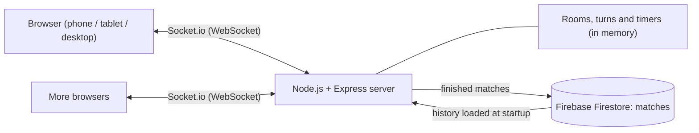
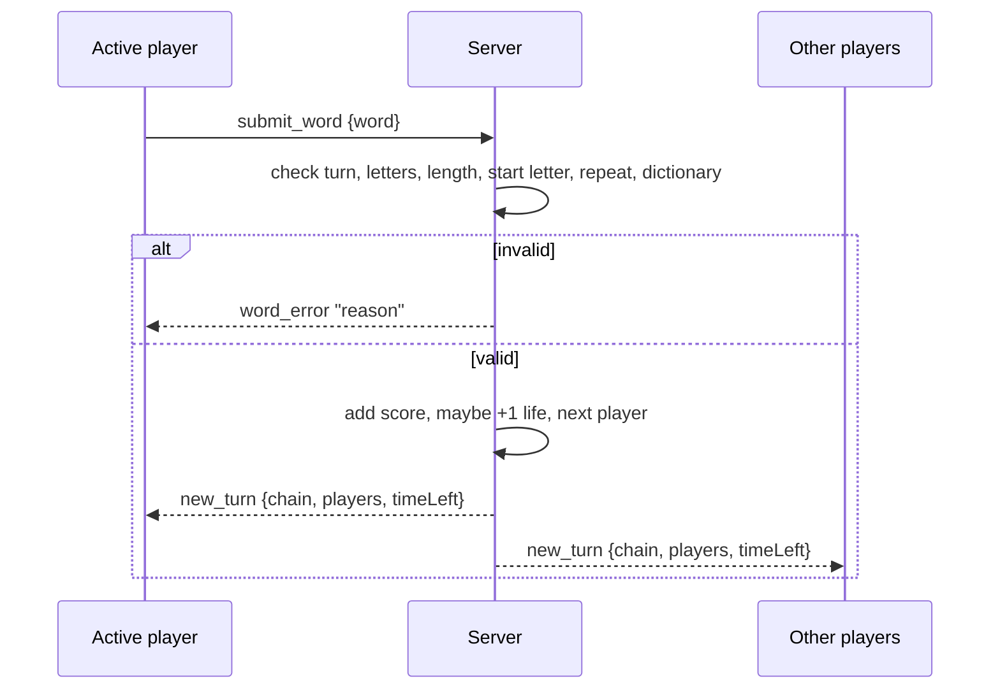

<div align="center">

## Word Chain: Real-Time Multiplayer Word Battle Online Game


# Word Chain

**A real-time multiplayer word battle for up to 8 players, on any screen.**

[](https://nodejs.org)
[](https://expressjs.com)
[](https://socket.io)
[](https://firebase.google.com/docs/firestore)
[](#testing)


**[Play the live demo](https://real-time-multiplayer-online-game-word.onrender.com/)** &nbsp;
</div>

---

## About

Word Chain is a fast, real-time multiplayer game. Players take turns typing a real English word that starts with the **last letter of the previous word**. You have 10 seconds per turn, three lives, and the highest score wins.

I built it to practise the parts of web development that are hard to fake: WebSocket communication, **server-authoritative game state**, timers and turn order under concurrency, persistent data, automated testing, and a UI that works from a small phone to a large monitor.


## Table of contents

- [Features](#features)
- [Screenshots](#screenshots)
- [How to play](#how-to-play)
- [Tech stack](#tech-stack)
- [Architecture](#architecture)
- [Getting started](#getting-started)
- [Environment variables](#environment-variables)
- [Firebase setup](#firebase-setup)
- [Testing](#testing)
- [Deployment](#deployment)
- [Socket events](#socket-events)
- [Security and reliability](#security-and-reliability)
- [Responsive design](#responsive-design)
- [Limitations and roadmap](#limitations-and-roadmap)
- [Author](#author)
- [License](#license)

## Features

**Multiplayer**
- Create a room with your own room ID and invite friends with a shareable link
- Request-based joining: the host accepts or declines each player
- Up to 8 players per room, with a ready check and a synchronized start countdown
- Nicknames are unique **per country** (the same name is allowed in different countries)

**Gameplay**
- 10-second turns, 3 lives, and scoring by word length (longer words also win back a life)
- Server-side validation: dictionary check, correct starting letter, minimum length, no repeated words
- Pause with a limit of 2 per player, and a synchronized resume countdown
- Fair handling of players who leave mid-match, including the player whose turn it is

**Results and ranking**
- Result popup with final scores, a 5-second countdown back to the lobby, and a close button to keep looking at the scores
- Public leaderboard of top players (wins, then best score)
- **Private match history:** "My matches" shows only the matches you played, with a search by Match ID. Nobody else can see them
- Finished matches are saved to **Firebase Firestore**, so they survive restarts and redeploys

**Quality**
- Mobile-first responsive layout for phones, tablets, laptops and large monitors
- 31 automated tests that start the real server and play real matches over WebSockets
- Input validation and crash-proof message handling on the server

## Screenshots

<table>
  <tr>
    <td width="50%"><br><sub><b>Lobby:</b> players, countries and ready status</sub></td>
    <td width="50%"><br><sub><b>Battle:</b> chain, target word, timer and live scores</sub></td>
  </tr>
  <tr>
    <td><br><sub><b>Result:</b> final scores and automatic return to the lobby</sub></td>
    <td><br><sub><b>Leaderboard:</b> top players and recent matches</sub></td>
  </tr>
  <tr>
    <td><br><sub><b>Pause:</b> freezes the clock for everyone</sub></td>
    <td><br><sub><b>Rules:</b> a short, point-by-point summary</sub></td>
  </tr>
</table>

### On phones

<p align="center">
  
  
  
  
</p>

### On tablets
<p align="center">
  
  
</p>

## How to play

1. **Chain:** type a real English word (3+ letters) starting with the last letter of the previous word.
2. **Time:** you have 10 seconds per turn. Running out of time costs 1 life and restarts the chain with a new word.
3. **Lives:** everyone starts with 3.
4. **Points:** 1 to 3 letters = 1 point, 4 letters = 2 points, 5+ letters = 4 points and +1 life (max 3).
5. **No repeats:** a word can be used only once per match.
6. **Pause:** 2 per player. Only the player who paused can resume.
7. **Win:** the match ends when one player is left with lives. The highest score wins, and equal top scores are a draw.
8. **Quit:** if everyone else leaves, the last player wins.

## Tech stack

| Layer | Technology |
| --- | --- |
| Server | Node.js 20+, Express 5 |
| Real-time | Socket.io 4 (WebSockets) |
| Database | Firebase Firestore (web SDK) |
| Word validation | `an-array-of-english-words` |
| Frontend | HTML, CSS and vanilla JavaScript (no framework, no build step) |
| Typography | Bricolage Grotesque and DM Sans |
| Testing | Node's built-in test runner (`node:test`) and `socket.io-client` |
| Hosting | Render (any Node host that supports WebSockets works) |

## Architecture



**Design decisions**

- **The server owns the game.** Clients only send intentions (for example "submit this word"). The server checks whose turn it is, validates the word, applies the score and broadcasts the new state. A modified client cannot cheat.
- **Live state stays in memory, results go to the database.** Rooms, turns and timers need to be fast and disposable. Only finished matches are written to Firestore, in the background, so a slow database can never stall a game.
- **One timer per room, one source of truth.** The server runs the turn clock and sends `timer_tick` events. The client only draws the bar.
- **Failure-tolerant persistence.** If Firestore is unreachable, matches stay in memory and the error is logged. The game keeps running.

**A turn, end to end**



## Getting started

**Prerequisites:** Node.js 20 or newer and npm.

```bash
# 1. Clone and install
git clone https://github.com/Abhayv273/<your-repo-name>.git
cd <your-repo-name>
npm install

# 2. Create your environment file
cp .env.example .env        # on Windows: copy .env.example .env

# 3. Start the server (auto-restarts on changes)
npm run dev
```

Open **http://localhost:3000** in two browser tabs (or a tab and your phone on the same Wi-Fi at `http://<your-computer-ip>:3000`). Create a room in one tab and join it from the other.

**Without Firebase:** you can leave the `FIREBASE_*` values empty. The game then saves matches to a local `data/matches.json` file, which is fine for development but is not durable on most hosting platforms.

## Environment variables

| Variable | Required | Description |
| --- | --- | --- |
| `PORT` | No | Port to listen on (default `3000`). Hosts like Render set it for you. |
| `FIREBASE_API_KEY` | For Firebase | From your Firebase web app config |
| `FIREBASE_PROJECT_ID` | For Firebase | Your Firebase project ID |
| `FIREBASE_APP_ID` | For Firebase | From your Firebase web app config |
| `FIREBASE_AUTH_DOMAIN` | No | From your Firebase web app config |
| `FIREBASE_STORAGE_BUCKET` | No | From your Firebase web app config |
| `FIREBASE_MESSAGING_SENDER_ID` | No | From your Firebase web app config |
| `TURN_SECONDS` | No | Length of a turn (default `10`) |
| `COUNTDOWN_SECONDS` | No | Start and resume countdown (default `3`) |
| `DISABLE_PERSISTENCE` | No | `1` = never save matches (used by the tests) |

The server uses Firebase only when `FIREBASE_API_KEY`, `FIREBASE_PROJECT_ID` and `FIREBASE_APP_ID` are all set. On startup it logs which storage it chose.

## Firebase setup

1. In the [Firebase Console](https://console.firebase.google.com), create a project and add a **web app** (the `</>` icon) to get your config values.
2. Open **Build, then Firestore Database, then Create database**. Choose the `(default)` database in Native mode and a location close to your players.
3. Open the **Rules** tab, paste the rules below, and click **Publish**.

```
rules_version = '2';
service cloud.firestore {
  match /databases/{database}/documents {
    match /matches/{id} {
      allow read: if true;
      allow create: if request.resource.data.keys().hasOnly(
        ['matchId','winner','winnerName','maxScore','players','timestamp'])
        && request.resource.data.players.size() <= 8;
      allow update, delete: if false;
    }
  }
}
```

4. Start the server. You should see `Storage: Firebase Firestore (collection: matches)` in the log. After a match ends with a score above zero, a new document appears in the `matches` collection.

> **Note:** a Firebase web config is public by design, so the rules above are what protect the data (documents can be created and read, but never changed or deleted). For a stricter setup, switch the server to `firebase-admin` with a service account and lock the rules down completely.

## Testing

```bash
npm install
npm test
```

The suite starts its own copy of the server on a random port for each group of tests and plays real matches over WebSockets using `socket.io-client`. It runs with `DISABLE_PERSISTENCE=1`, so it **never writes to Firebase or to disk**. All 31 tests pass in about 45 seconds.

| Area | What is verified |
| --- | --- |
| Rooms | Creating, joining, declining and cancelling requests, the 8-player limit, host hand-over |
| Nicknames | Unique per country across rooms (ignoring case and spaces), reserved while a request is waiting |
| Start | Ready check, countdown, cancelling by un-readying, no late joiners |
| Words | Every invalid-word error, no repeats, only the active player can answer |
| Scoring | 1 / 2 / 4 points, extra life for 5+ letters, capped at 3 lives |
| Timer | Timeout costs a life and restarts the chain, equal scores end in a draw |
| Pause | 2 per player, only the initiator can resume, the clock stays frozen, hand-over if the initiator leaves |
| Endings | Last player wins when others quit, the match survives the active player leaving |
| Privacy | Only a match's players can see it (including a player who quit), strangers get nothing, no key hashes leak, the public leaderboard carries no match details |
| Robustness | Malformed messages never crash the server, strangers cannot control a room |

## Deployment

The server needs a host that supports long-running WebSocket connections, so serverless platforms such as Vercel are not suitable for it. These steps use Render:

1. Push the project to GitHub (`.env` and `data/` are already in `.gitignore`).
2. On [render.com](https://render.com) choose **New, then Web Service**, and select your repository.
3. Set the **Build command** to `npm install` and the **Start command** to `npm start`.
4. Under **Environment Variables**, add your `FIREBASE_*` values. Do not set `PORT`.
5. Deploy, then open `https://<your-service>.onrender.com/health`. It should return `OK`.

**Free-tier notes:** the service sleeps after about 15 minutes without visitors, so the first request can take 30 to 60 seconds. Live rooms are held in memory, so a restart ends running matches (saved results stay in Firestore). Run a single instance.

## Socket events

**Client to server**

| Event | Payload | Purpose |
| --- | --- | --- |
| `create_room` | `{ room, name, country }` | Create a room and become host |
| `request_join` | `{ room, name, country }` | Ask the host to let you in |
| `cancel_request` | none | Withdraw a waiting request |
| `accept_request` / `reject_request` | `{ targetId }` | Host answers a request |
| `toggle_ready` | none | Mark ready or not ready |
| `submit_word` | `{ word }` | Play a word on your turn |
| `request_pause` / `request_resume` | none | Pause for everyone / resume |
| `quit_game` | none | Leave the room or match |
| `get_global_leaderboard` | none | Request the public top-players list |
| `get_my_history` | `{ key }` | Request the matches this browser's player took part in |

**Server to client**

| Event | Purpose |
| --- | --- |
| `join_success`, `join_error`, `waiting_for_host` | Result of a create or join attempt |
| `join_request_received`, `request_cancelled` | Join requests, sent to the host |
| `update_players` | Room roster, ready flags and host |
| `match_countdown`, `match_countdown_cancelled`, `game_started` | Match start flow |
| `new_turn` | Active player, current word, chain, scores, lives and clock |
| `timer_tick`, `turn_timeout` | Turn clock and time-out notice |
| `word_error` | Why a word was rejected |
| `game_paused`, `pause_denied`, `resume_countdown`, `game_resumed` | Pause flow |
| `player_left`, `game_over` | Departures and the final result |
| `global_leaderboard_data` | Top players (no match details) |
| `my_history_data` | The requesting player's own matches only |

## Security and reliability

- **Server-authoritative rules:** every action is checked on the server (turn order, word validity, host-only actions, room membership).
- **Input handling:** nicknames and room IDs are trimmed, length-limited and stripped of HTML characters; all user text is escaped again before it is shown.
- **Crash-proof handlers:** every Socket.io handler receives a safe payload and is wrapped in `try/catch`. A regression test sends `null`, numbers, strings and arrays to every event and checks that the server stays up. This was a real bug (one malformed message could crash the server) found during testing.
- **Bounded game loop:** turn advancing never loops forever, and the turn pointer stays valid when players leave.
- **Secrets:** configuration lives in `.env` (git-ignored); `.env.example` documents it without values.
- **Private match history:** each browser keeps a random secret key; only its SHA-256 hash is stored with a match. The server returns a match only to a player whose key matches, and a Match ID on its own unlocks nothing. Hashes are never sent to any client.
- **Database rules:** Firestore documents can be created and read but never edited or deleted. Because the server uses the public web config, someone who knows your project settings could still read match records straight from Firestore. For full database-level privacy, switch the server to `firebase-admin` and lock the rules to `allow read, write: if false`.
- **No accounts yet:** history belongs to the browser. Clearing site data or switching device starts a fresh history.

## Responsive design

The layout is mobile-first and was checked at phone, tablet, laptop and large-monitor sizes, including landscape phones.

| Size | What changes |
| --- | --- |
| Small phones (up to 360px) | Tighter spacing, stacked form fields |
| Phones | Players stacked vertically, battle screen fills the height, input in the thumb zone |
| Tablets (600px and up) | Centered layout, player grid |
| Laptops (900px and up) | Players in a side panel next to the board |
| Large monitors (1440px and up) | Wider layout and larger letter tiles |
| Short landscape phones | Side-by-side layout to save height |

Safe-area insets keep content clear of notches, and animations switch off for users who prefer reduced motion.

## Project structure

```
.
├── server.js            Express + Socket.io server, game rules, persistence
├── public/
│   ├── index.html       Markup for all screens and dialogs
│   ├── style.css        Design system, responsive layout
│   └── script.js        Client logic, rendering, socket events
├── test/
│   └── server.test.js   31 automated end-to-end tests
├── docs/                README banner and screenshots
├── .env.example         Documented configuration (no secrets)
├── package.json
└── LICENSE
```

## Limitations and roadmap

**Current limitations**
- Players are anonymous (no accounts), and a dropped connection removes the player from the room.
- Live rooms are in memory, so the server runs as a single instance.
- No chat, sound or rematch button yet.
- Browsers based match history(Temporary).
- No login/Signup (Direct-Play)

**Future Planned**
- [ ] Solo practice mode against a bot, so the game is playable without other people online
- [ ] Hands-free voice mode for kids to learn vocabulary and spelling (speech recognition and text-to-speech) ⭐
- [ ] Reconnect support, so a phone that switches apps can rejoin
- [ ] Rematch button and optional sound effects with a mute switch
- [ ] `firebase-admin` with locked-down database rules
- [ ] Rate limiting and a Redis adapter for running several server instances


## Author

**Abhay Verma**, full-stack developer (MERN) | Open to Opportunities | SDE(Entry-Level)

[LinkedIn](https://www.linkedin.com/in/abhay-verma-36488325b) &nbsp;|&nbsp; [Email](https://mail.google.com/mail/?view=cm&fs=1&to=abhay73verma%40gmail.com&utm_source=chatgpt.com)

## License

Fonts: [Bricolage Grotesque](https://fonts.google.com/specimen/Bricolage+Grotesque) and [DM Sans](https://fonts.google.com/specimen/DM+Sans) (SIL Open Font License). Word list: [`an-array-of-english-words`](https://www.npmjs.com/package/an-array-of-english-words).
